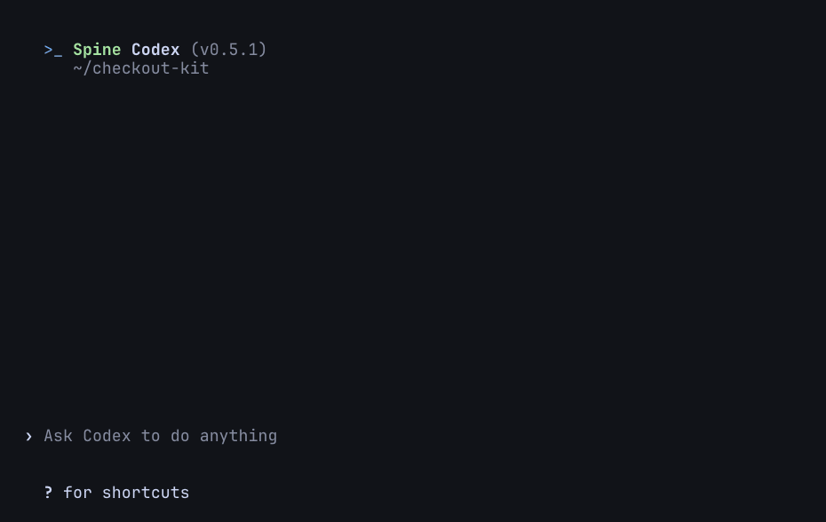
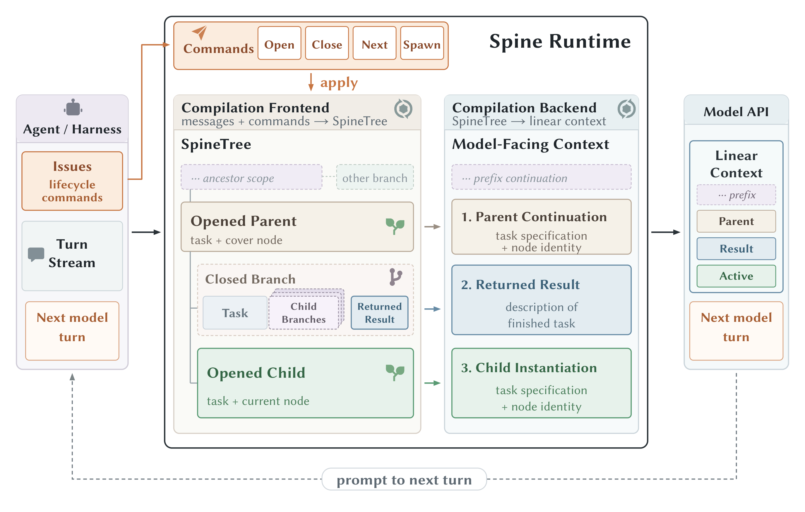

<h1 align="center"> SpineCodex</h1>

<p align="center"><em>OpenAI Codex powered by Spine &mdash; compile subtask trees into structured context for long-horizon coding.</em></p>

<p align="center">
  <a href="https://arxiv.org/abs/2610.37224"></a>
  &middot;
  <a href="https://www.npmjs.com/package/@spinejit/spine-codex"></a>
  &middot;
  <a href="https://www.npmjs.com/package/@spinejit/spine-codex"></a>
  &middot;
  <a href="./LICENSE"></a>
</p>

<p align="center">English &middot; <a href="./README.zh-CN.md">&#x7B80;&#x4F53;&#x4E2D;&#x6587;</a></p>

<p align="center">
  
</p>

## Overview

Long-horizon software engineering naturally unfolds as nested subtasks, yet large language models consume a prefix-sensitive linear context. Flat history compaction loses subtask boundaries and triggers repeated file rereads, while spawning a child agent for every subtask adds heavy cross-session handoff and waiting overhead on sequential work.

**SpineCodex** places long-horizon execution under a persistent work tree (**`SpineTree`**)&mdash;acting as the **structural spine** from which subtasks branch out and fold back. The agent declares subtask boundaries as it reasons, keeping local sequential steps inline while delegating independent branches in parallel when needed. Before each model call, the Spine runtime compiles `SpineTree` into minimal effective context&mdash;replacing completed subtasks with their returned results while keeping unfinished parent context byte-for-byte intact for prefix-cache reuse.

## Quick Start

Install globally and run directly&mdash;SpineCodex inherits your existing `~/.codex` configuration, credentials, and skills out of the box:

```bash
npm install -g @spinejit/spine-codex@latest
spine-codex
```

- **Upstream compatibility**: `v0.5.1` tracks OpenAI Codex `0.164.0`, supporting `GPT-6.1-Sol`, `GPT-6-Astra`, and other frontier models.
- **Optional local memory view**: Run `/experimental` in the TUI to enable `Spinetree memory projection` (exports closed-node memory under `.codex/spinetree/` for inspection).

## How Spine Works

<p align="center">
  
</p>

Spine resolves the tension between nested work and linear context across three coordinated layers:

- **Agent-declared boundaries, runtime-managed structure**: As the agent reasons, it marks subtask entries and conclusions via lightweight primitives (`Open`, `Close`, `Next`, `Spawn`). The compilation frontend maintains the persistent `SpineTree` so completed intermediate traces remain archived without cluttering active context.
- **Unified work tree without unnecessary subagent overhead**: `SpineTree` decouples boundary management from subagent spawning&mdash;sequential subtasks open and close locally within the current session (`Open` / `Close` / `Next`), while independent tasks scale out in parallel via `Spawn`, returning results into the same tree.
- **Just-in-time context compilation & prefix-cache hits**: Because innermost subtasks finish first, completed branches collapse at the active suffix into concise returned results. Preceding parent context stays unchanged and continues to hit prompt caches.

For formal definitions, compilation rules, and ablation studies, see the paper: [*Spine: Compiling Subtask Trees into Structured Context for Long-Horizon Coding Agents*](https://arxiv.org/abs/2610.37224).

## Benchmark Highlights

Evaluated across three long-horizon software engineering benchmarks ([arXiv:2610.37224](https://arxiv.org/abs/2610.37224)):

| Benchmark | Setting | SpineCodex vs. Baseline |
| :--- | :--- | :--- |
| **[SWE-Milestone](https://github.com/DeepCommit-ai/SWE-Milestone)** | `GPT-5.6 Sol` (98 milestones) | **42.6% vs. 38.1% Score (+11.8%)**, **19 vs. 14** resolved, **-45%** avg. input tokens/req, **-32.4% total cost** vs. native Codex |
| **SWE-Milestone** | `Grok 4.6` (98 milestones) | **40.4% vs. 35.5% Score (+13.8%)**, **-37.9% total cost** vs. native Codex |
| **SWE-Milestone** | Context-management baselines (`GPT-5.6 Sol`) | **-73.7% total cost** vs. recursive subagent delegation (`19 vs. 17` resolved); **+14.8%&ndash;16.7% Score** & **-22.7%&ndash;58.1% cost** vs. history compression/folding |
| **[ProgramBench](https://programbench.com)** | `GPT-5.6 Sol` / `Grok 4.6` (50 tasks) | **73.35% vs. 62.55% (+17.3% rel.)** avg. pass rate & **7/50 vs. 2/50** tasks &ge;95% (`GPT-5.6 Sol`); **+10.2%** avg. pass rate & **-13.3% cost** (`Grok 4.6`) |
| **[FrontierSWE](https://www.frontierswe.com)** | 10 open-ended tasks (5 trials/task) | Improves Mean@5 on **8/10** tasks (`GPT-5.6 Sol`, **-6.7% cost**) and **6/10** tasks (`Grok 4.6`, **-19.2% cost**) |

<details>
<summary>Recent Releases</summary>

- **v0.5.1 / v0.5.0** &mdash; Updates upstream OpenAI Codex baseline to `0.164.0` with full `GPT-6.1-Sol` / `GPT-6-Astra` support, embedded app-server startup isolation, prompt-cache preservation in spawned children, and Spine lineage preservation across compacted sessions.
- **v0.4.0** &mdash; Updates upstream baseline to `0.153.4` and removes legacy 4096-item source-ledger and 1 MiB synthetic context-plan caps for ultra-long sessions.
- **v0.3.0** &mdash; Introduces the SpineSDK sampling-boundary runtime with unified `Open` / `Close` / `Next` / `Spawn` primitives.

Full release notes: [GitHub Releases](https://github.com/GhabiX/SpineCodex/releases).
</details>

## Spine Ecosystem

- **SpineCodex** (this repository) &mdash; Standalone Codex CLI distribution with Spine built in (`@spinejit/spine-codex`).
- **[Spine for Pi & DeepSeek Harness](https://github.com/GhabiX/spine-plugin)** &mdash; Official Spine plugins for [Pi](https://github.com/badlogic/pi-mono) (`@spinejit/pi-spinejit`) and DeepSeek Harness (`@spinejit/dsh-spinejit`), plus companion TUI extensions including [`@spinejit/pi-compact-tree`](https://github.com/GhabiX/pi-compact-tree).

## Citation

If you find Spine or SpineCodex useful in your research or engineering workflow, please cite our paper:

```bibtex
@misc{xiang2026spine,
  title         = {Spine: Compiling Subtask Trees into Structured Context for Long-Horizon Coding Agents},
  author        = {Jiahong Xiang and Kunqiu Chen and Lingming Zhang and Yuqun Zhang},
  year          = {2026},
  eprint        = {2610.37224},
  archivePrefix = {arXiv},
  primaryClass  = {cs.SE},
  url           = {https://arxiv.org/abs/2610.37224}
}
```

## License & Contributing

SpineCodex is maintained by [Jiahong Xiang](https://ghabix.github.io) and [Kunqiu Chen](https://camsyn.github.io) under the [Apache-2.0 License](LICENSE). Upstream [OpenAI Codex](https://github.com/openai/codex) and derived components retain their attribution in [NOTICE](NOTICE). Bug reports and feature discussions are welcome in [GitHub Issues](https://github.com/GhabiX/SpineCodex/issues).
