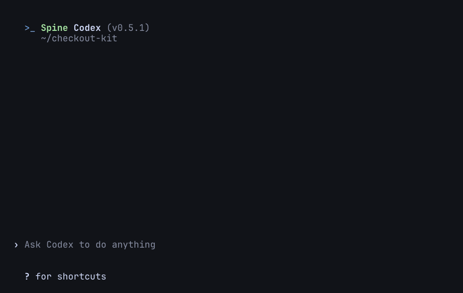
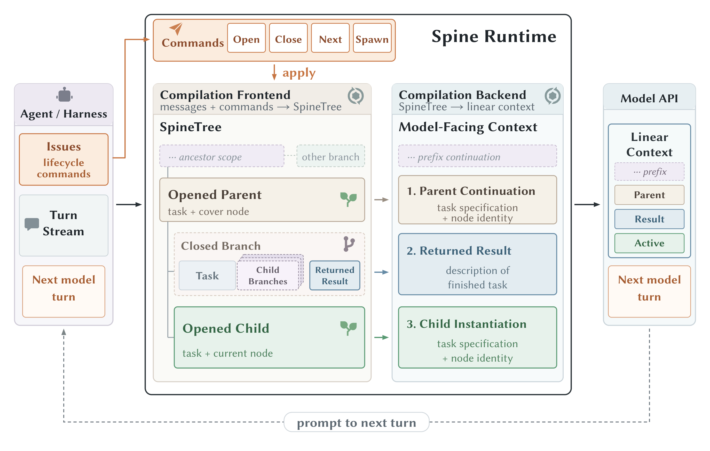

<h1 align="center"> SpineCodex</h1>

<p align="center"><em>内置 Spine 的开源 Codex 发行版 —— 将持久化子任务树即时编译为结构化上下文。</em></p>

<p align="center">
  <a href="https://arxiv.org/abs/2610.37224"></a>
  ·
  <a href="https://www.npmjs.com/package/@spinejit/spine-codex"></a>
  ·
  <a href="https://www.npmjs.com/package/@spinejit/spine-codex"></a>
  ·
  <a href="./LICENSE"></a>
</p>

<p align="center"><a href="./README.md">English</a> · 简体中文</p>

<p align="center">
  
</p>

## 简介

跨模块重构、版本迁移与整仓构建等长程开发工作天然具有嵌套子任务结构，但大模型接收的是前缀敏感的线性上下文：按长度直接压缩容易冲掉外层未完成任务仍需依赖的信息、引发反复重读；每逢局部步骤都派生独立子会话又会带来跨会话协调与等待开销。

**SpineCodex** 将整个长程执行过程统一纳入一棵持久化工作树（**`SpineTree`**）进行管理——作为支撑长程执行的**结构主干（Spine）**：智能体在推理决策的同时显式声明局部任务边界，串行步骤留在当前会话内轻量开合，独立任务按需并行委派；运行时在每次调用模型前将 `SpineTree` 即时编译为最小有效上下文，在收起已完成步骤细节的同时持续复用前缀缓存。

## 快速开始

全局安装后直接启动，自动继承现有的 `~/.codex` 配置、登录态与技能，开箱即用：

```bash
npm install -g @spinejit/spine-codex@latest
spine-codex
```

- **上游版本同步**：当前 `v0.5.1` 同步上游 OpenAI Codex `0.164.0`，完整支持 `GPT-6.1-Sol`、`GPT-6-Astra` 等最新模型。
- **可选本地记忆导出**：在终端运行 `/experimental` 可开启 `Spinetree memory projection`（将已闭合节点记忆导出至 `.codex/spinetree/` 便于本地查阅）。

## 核心机制

<p align="center">
  
</p>

Spine 围绕持久化工作树 `SpineTree` 从机制上解决长程上下文管理的三个核心矛盾：

- **智能体显式划界，运行时维护结构**：智能体通过 `Open`、`Close`、`Next`、`Spawn` 原语在推理时直接声明局部任务的起止与结论；编译前端实时更新 `SpineTree`，已完成分支的完整交互归档留存、不会丢失。
- **统一工作树管理，剥离额外调度开销**：所有工作在 `SpineTree` 下统一受控管理，将“任务边界维护”与“子智能体委派”分解开——串行局部任务直接在当前会话内通过 `Open / Close / Next` 轻量开合，需要并行分治时再通过 `Spawn` 委派子智能体，省去了递归子智能体方案在串行步骤上的跨会话开销。
- **即时编译线性上下文，持续命中前缀缓存**：由于最内层子任务最先完成，每次闭合收起天然发生在上下文末尾——编译后端保留外层未完成工作的前序上下文与当前活跃子任务细节，将已完成节点替换为其返回结论，前序前缀保持不变，持续命中前缀缓存。

完整形式化定义、编译规则与消融实验详见论文：[*Spine: Compiling Subtask Trees into Structured Context for Long-Horizon Coding Agents*](https://arxiv.org/abs/2610.37224)。

## 实验结果速览

在三类互补的长程软件工程基准上的系统评估结果（[arXiv:2610.37224](https://arxiv.org/abs/2610.37224)）：

| 评测基准 | 模型与设定 | SpineCodex 对比基线核心结果 |
| :--- | :--- | :--- |
| **[SWE-Milestone](https://github.com/DeepCommit-ai/SWE-Milestone)** | `GPT-5.6 Sol`（98 个里程碑） | **得分 42.6% vs. 38.1%（+11.8%）**，解决 **19 vs. 14** 个里程碑，单次平均输入减少 **45%**，对比原生 Codex **总成本降低 32.4%** |
| **SWE-Milestone** | `Grok 4.6`（98 个里程碑） | **得分 40.4% vs. 35.5%（+13.8%）**，对比原生 Codex **总成本降低 37.9%** |
| **SWE-Milestone** | 上下文管理基线对比（`GPT-5.6 Sol`） | 对比递归子智能体委派**总成本降低 73.7%**（解决 `19 vs. 17`）；对比历史压缩与单层折叠方法**得分提升 14.8%–16.7%**、**成本降低 22.7%–58.1%** |
| **[ProgramBench](https://programbench.com)** | `GPT-5.6 Sol` / `Grok 4.6`（50 个整仓重建任务） | `GPT-5.6 Sol` 平均测试通过率 **73.35% vs. 62.55%（相对 +17.3%）**，高分任务（≥95%）**7/50 vs. 2/50**；`Grok 4.6` 平均通过率 **+10.2%**、**成本 -13.3%** |
| **[FrontierSWE](https://www.frontierswe.com)** | 10 个开放复杂工程任务（每任务 5 次独立运行） | `GPT-5.6 Sol` 在 **8/10** 个任务上提升 Mean@5（**成本 -6.7%**）；`Grok 4.6` 在 **6/10** 个任务上双指标提升（**成本 -19.2%**） |

<details>
<summary>近期版本更新</summary>

- **v0.5.1 / v0.5.0** — 同步上游 OpenAI Codex 基线至 `0.164.0`，支持 `GPT-6.1-Sol` / `GPT-6-Astra`，隔离官方 Codex 守护进程启动路径，并在派生子会话与压缩恢复中完整保持提示词缓存键与 Spine 谱系。
- **v0.4.0** — 同步上游基线至 `0.153.4`，解除超长会话下 4096 条历史账本上限与 1 MiB 合成计划字节上限。
- **v0.3.0** — 引入基于 SpineSDK 采样边界的统一运行时与 `Open / Close / Next / Spawn` 原语。

完整更新记录见 [GitHub Releases](https://github.com/GhabiX/SpineCodex/releases)。
</details>

## 开源生态

- **SpineCodex**（本仓库）—— 内置 Spine 的独立 Codex 发行版（`@spinejit/spine-codex`）。
- **[Spine for Pi & DeepSeek Harness](https://github.com/GhabiX/spine-plugin)** —— 面向开源框架 [Pi](https://github.com/badlogic/pi-mono)（`@spinejit/pi-spinejit`）与 DeepSeek Harness（`@spinejit/dsh-spinejit`）的官方插件，以及配套终端紧凑过程树插件 [`@spinejit/pi-compact-tree`](https://github.com/GhabiX/pi-compact-tree)。

## 引用

如果 Spine 或 SpineCodex 对你的研究或工程工作有帮助，欢迎引用我们的论文：

```bibtex
@misc{xiang2026spine,
  title         = {Spine: Compiling Subtask Trees into Structured Context for Long-Horizon Coding Agents},
  author        = {Jiahong Xiang and Kunqiu Chen and Lingming Zhang and Yuqun Zhang},
  year          = {2026},
  eprint        = {2610.37224},
  archivePrefix = {arXiv},
  primaryClass  = {cs.SE},
  url           = {https://arxiv.org/abs/2610.37224}
}
```

## 许可证与贡献

SpineCodex 由 [香佳宏 (Jiahong Xiang)](https://ghabix.github.io) 与 [陈昆秋 (Kunqiu Chen)](https://camsyn.github.io) 维护，采用 [Apache-2.0 许可证](LICENSE)。上游 [OpenAI Codex](https://github.com/openai/codex) 及相关派生组件署名保留在 [NOTICE](NOTICE) 中。欢迎通过 [GitHub Issues](https://github.com/GhabiX/SpineCodex/issues) 反馈问题与交流想法。
